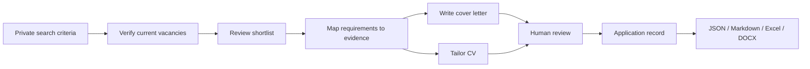

# AI Job Application Workflow

An AI-assisted job application workflow integrating verified job discovery, Codex-powered document tailoring, structured application tracking, and privacy-focused validation.

The project turns a fragmented, repetitive process into a reusable workflow with source verification, evidence-based writing, deterministic validation, and human review. These design patterns are transferable to finance, risk, analytics, and other environments where automation must remain traceable and reliable.

## Key features

- **Verified job discovery:** searches current sources, checks primary vacancy pages, records observation dates, and detects duplicate requisitions.
- **Evidence-based cover letters:** researches current official application guidance and maps vacancy requirements to candidate evidence before drafting.
- **Full CV tailoring:** adapts the profile, section order, bullet emphasis, skills, projects, and interests while preserving the underlying facts.
- **Reviewable document variants:** assigns vacancy-specific version IDs and records accepted or rejected changes with their supporting evidence.
- **Structured application tracking:** separates vacancy status from candidate status and preserves date precision, source evidence, materials, and review decisions.
- **Privacy and reliability controls:** keeps candidate data outside version control and combines a redacting privacy scanner, JSON Schema, business rules, and human approval gates.
- **Portable Codex skills:** packages three reusable workflows through the Agent Plugins layout, with a reproducible fictional demonstration.

## Architecture



Job discovery can run on demand or through an external scheduler. Candidate facts and application records remain in user-controlled private storage, while the public repository contains reusable workflow definitions, validation tools, and fictional examples.

See [the architecture documentation](docs/architecture.md) for the evidence model, state design, and adapter flow.

## Tech stack

| Area | Technology |
| --- | --- |
| Agent workflows | Codex Skills and Agent Plugins |
| Validation | Python, JSON Schema, PyYAML |
| Configuration | YAML with environment-variable placeholders |
| Documentation | Markdown and Mermaid |
| Quality assurance | `unittest`, privacy scanning, GitHub Actions |
| Local integrations | JSON, Markdown, Excel, and DOCX adapter contracts |

## Quick start

### Use with Codex—no command line required

1. Choose **Code → Download ZIP** on GitHub and unzip the download.
2. Open the folder as a project in Codex.
3. Send this message:

```text
Install the three skills under this project's skills folder as my user skills.
Keep my candidate profile, CV, letters, job-search preferences, and application
records outside this repository. Tell me when I should start a new chat.
```

4. Start a new chat and describe the task naturally, or invoke a workflow directly:

```text
$find-and-track-jobs Search for current roles matching my private criteria.
$write-cover-letter Write a letter for this vacancy using my private candidate facts.
$tailor-cv Tailor my private CV for this vacancy without changing my facts.
```

For manual installation:

```bash
mkdir -p ~/.agents/skills
cp -R skills/find-and-track-jobs ~/.agents/skills/
cp -R skills/write-cover-letter ~/.agents/skills/
cp -R skills/tailor-cv ~/.agents/skills/
```

Copy `config.example.yaml` to a private folder and connect your own candidate profile, CV baseline, output workspace, search preferences, and tracking files there.

## Fictional demonstration

The included demonstration generates a targeted CV, cover letter, and change-review record from an invented candidate, vacancy, guidance record, and requirement-to-evidence map:

```bash
git clone https://github.com/syw8/ai-job-application-workflow.git
cd ai-job-application-workflow
python3 scripts/generate_fictional_documents.py \
  --input examples/fictional-demo/document-input.json \
  --output-dir examples/fictional-demo/generated
```

See the [end-to-end walkthrough](docs/end-to-end-fictional-walkthrough.md) and the checked-in [fictional output](examples/fictional-demo/generated/).

## Testing

The repository includes automated privacy, schema, business-rule, workflow-structure, and deterministic document-generation tests. GitHub Actions runs the same checks on every push and pull request.

```bash
python3 -m venv .venv
. .venv/bin/activate
python3 -m pip install -r requirements-dev.txt
bash scripts/run_checks.sh
```

The privacy scanner supports a private external denylist and reports redacted file identifiers rather than matching content.

## Documentation

- [System architecture](docs/architecture.md)
- [Implementation map](docs/component-status.md)
- [Fictional end-to-end walkthrough](docs/end-to-end-fictional-walkthrough.md)
- [Optional scheduled discovery](docs/scheduled-discovery.md)
- [Privacy policy](PRIVACY.md)
- [Security policy](SECURITY.md)

## License

MIT
