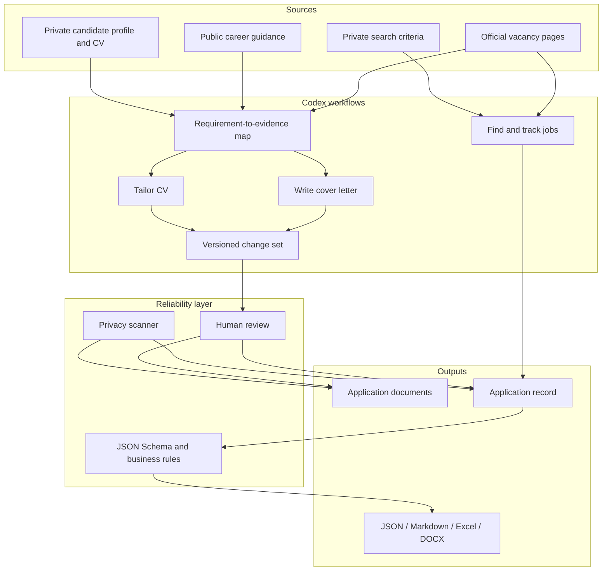

# System architecture

The workflow combines agent-directed research and writing with deterministic validation. It separates public source evidence, private candidate facts, document generation, and application-state management so that each output remains traceable.

## Discovery and source verification

`find-and-track-jobs` starts with private criteria such as role, location, work mode, language, and exclusions. It verifies the primary vacancy page and captures the organization, role, requisition ID, location, deadline precision, source URL, observation date, and vacancy status.

Deduplication compares requisition IDs, canonical URLs, organizations, titles, locations, and observation dates. Search results remain source-linked so a reviewer can trace each shortlisted role.

## Evidence-based document tailoring

`write-cover-letter` and `tailor-cv` combine three evidence sets:

1. the vacancy and employer instructions;
2. current official guidance for the target market;
3. the candidate's private profile and document sources.

A requirement-to-evidence map classifies direct, transferable, missing, and uncertain matches before drafting. The same map supports both the cover letter and the CV, keeping the documents consistent while allowing each to serve a different purpose.

The cover-letter workflow can draft from a candidate profile or use an existing letter as a voice reference. The CV workflow can change the complete presentation—summary, order, emphasis, bullets, projects, skills, and interests—while protecting identities, organizations, dates, credentials, results, and proficiency levels.

Each vacancy-specific document receives a stable version ID. Material proposals record their rationale and supporting evidence, and the reviewed version contains only accepted changes. The private application record links uploads and submissions to those exact document versions.

## Application-state model

The record model keeps two state dimensions separate:

- `application_status` records the candidate's process, from planning through submission, interview, offer, rejection, withdrawal, or decline;
- `vacancy_status` records the observed availability of the job listing.

Dates preserve day, month, year, range, or unknown precision. Evidence is attached to individual facts, and consequential status changes require direct evidence and review.

## Adapters

One reviewed record can be reconciled across JSON, Markdown, Excel, and a DOCX timeline. Adapter contracts preserve stable IDs, existing formatting, formulas, hyperlinks, evidence dates, and update history. Cross-adapter comparison identifies disagreements before they become silent data drift.

## Reliability and privacy

JSON Schema validates configuration and application records. Python business rules cover evidence strength, date precision, duplicate requisitions, upload claims, status transitions, and adapter consistency. The privacy scanner checks public files for local paths, personal identifiers, credentials, private filenames, contact details, and blocked binary artifacts while redacting matched content from its output.

Candidate documents, configuration, search preferences, generated applications, and tracker data remain in user-controlled private locations. Human review connects the agent workflows to the final documents and records.
